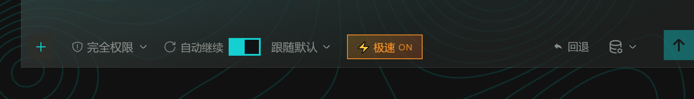
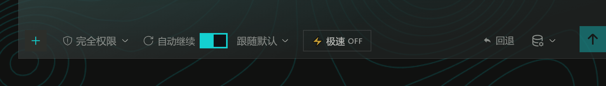
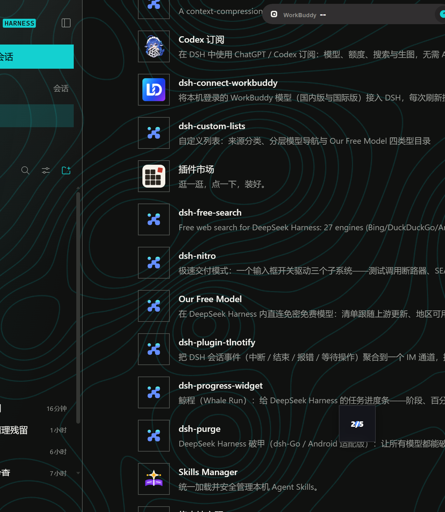

# dsh-nitro

**输入框里随时开关的「极速交付」插件。** 一个 ⚡ 开关驱动三个独立子系统，默认**关**（`{"enabled": false}`），不改变 DSH 的任何默认行为。

插件名 `nitro` 取自「氮气加速」——只在需要把想法一口气推到成品时才按下，松手即恢复常规工作流。







---

## 三个子系统

| 子系统 | 落点 | 行为 |
| --- | --- | --- |
| **断路器 Circuit Breaker** | `tools/execute` waterfall | 命中测试/构建/lint 类命令时**不真正执行**，直接返回 schema 合法的 `exitCode: 0` 回执，模型看到「已通过」继续交付 |
| **SEARCH/REPLACE 引擎** | `apply_patch` 工具 | 只输出 `<<<<<<< SEARCH` / `=======` / `>>>>>>> REPLACE` 块，本地一次原子写入；**任一块锚点未命中或歧义 → 整次回滚并报错，盘上零改动** |
| **终端脱水 Dehydrator** | `tools/post-execute` waterfall | 验证类命令通过 → 只回 `All tests passed.`；失败 → 滤掉 INFO/WARN/DEBUG 与堆栈帧，只留最后 15 行 |

三者共用一个开关，可以独立失效：关掉时三个钩子全部 `return next()`，工具调用与输出原样透传。

---

## 开关

- 状态文件：`$DSH_HOME/nitro.json`（默认 `{"enabled": false}`），跨会话保留
- `GET /nitro/state` → `{ok, enabled, stats, version}`
- `POST /nitro/toggle` → 无 body 取反，`{enabled:true|false}` 指定
- 界面：输入框左侧 ⚡ 按钮（`conversation.input.left` 槽，id `nitro`，order 20），多标签页通过 `dsh-nitro:changed` 事件与 4 秒轮询保持一致

```bash
curl http://127.0.0.1:<port>/nitro/state
curl -X POST http://127.0.0.1:<port>/nitro/toggle -d '{"enabled":true}'
```

---

## 系统提示注入

开启时向 system prompt 注入 `nitro` 段（order 400，位于 `PLAN_POLICY` 之前），告知模型三件事：测试会被拦截且结果不代表真实执行、改文件必须走 `apply_patch`、终端输出已脱水不要索取完整日志。关闭时该段为空字符串，完全静默。

这段提示是插件「自主关闭循环」的关键——模型知道短路规则存在，才会一次交付而不是反复验证。

---

## apply_patch 用法

```json
{
  "file_path": "src/app.ts",
  "patch": "<<<<<<< SEARCH\nconst port = 3000\n=======\nconst port = 8080\n>>>>>>> REPLACE"
}
```

- 一个 `patch` 里可放多个块，按顺序作用于内存副本，**全部命中才写盘**
- 锚点在文件里出现多次且未传 `replace_all: true` → 报错不写盘
- 锚点一次都没命中 → 报错并回显锚点前几行，便于自我修正
- `SEARCH` 与 `REPLACE` 完全相同（无变化）→ 报错不写盘
- 返回 `{path, blocks, replacements, before, after}`，写盘带 `replaceIfVersion` 版本校验与 fs 沙箱策略，与官方 `edit` 工具同一套安全边界

---

## 拦截边界

**拦截**（判定为验证工作）：`pytest` / `py.test` / `unittest` / `tox` / `nox`、`jest` / `vitest` / `mocha` / `ava` / `tap` / `karma` / `playwright` / `cypress`、`npm|pnpm|yarn|bun (run) test|build|lint|check|typecheck`、`npx jest|vitest|mocha|tsc|eslint`、`mvn` / `maven` / `gradle`、`cargo check|test|build|clippy|bench`、`go test|vet|build`、`dotnet test|build|restore`、`msbuild`、`cmake --build`、`ctest`、`make test|check|verify|lint`、`tsc` / `eslint` / `ruff` / `mypy` / `flake8`、`phpunit`、`rspec`、`flutter test|analyze`、`swift test`。

**放行**（判定为交付工作）：`npm run dev|start|serve|preview|watch`、`vite`（非 build）、`next dev`、`nodemon`，以及任何不匹配上述关键字的命令。服务器类命令被明确排除在断路器之外，否则「启动一下看看」会被短路成假成功。

---

## 与其他插件的兼容性

- 只挂 `tools/execute`、`tools/post-execute` 两个 waterfall 与一个 `systemPrompt.section`，全部各自持有独立 disposer，卸载时自动摘除
- `conversation.input.left` 是 list 槽位，与 `dsh-client-auto-continue`（`auto-continue`）、`dsh-codex-subscription`（`codex-image-workspace`）等并存无冲突
- 新工具名 `apply_patch` 与核心包及已知插件均不重名
- 不修改 `node_modules` 下任何运行时包，不依赖 `dsh-purge` 之类的补丁式改造
- 客户端零 CSS、零 locale 服务、零全局状态，最坏情况只是按钮不显示，不会破坏输入框

---

## 安装

从 GitHub release 装（预构建 tgz，无需 `allowBuilds` 授权）：

```bash
dsh plugin --profile web add https://github.com/clockclock1/dsh-nitro
```

也可以从插件市场安装（收录后）：

```bash
dsh plugin --profile web add clockclock1/dsh-nitro
```

本地开发时用 `link-profile.mjs` 装配（generation 目录 + junction + `package.json` 三处条目）：

```bash
node link-profile.mjs          # 装配进 web profile
node link-profile.mjs --revert # 撤销
```

装配后需重载插件使其生效（运行中的 Cordis 实例持有旧模块）。

---

## 目录

```
lib/index.js        host 半边：断路器、脱水器、apply_patch、状态路由、提示注入
lib/client.js       客户端半边：输入框 ⚡ 开关
cordis.patch.yml    插件装配补丁
link-profile.mjs    本地装配 / 撤销脚本
screenshots.json    市场详情页截图清单（路径相对仓库根）
screenshots/        截图资源
icon.png            市场列表图标（256×256）
CHANGELOG.md        版本记录
LICENSE             MIT
probe-*.mjs         离线自检脚本（mock ctx / mock ModuleLoader）
shoot.mjs           截屏脚本（CDP 驱动运行中的 DSH Web GUI）
gen-icon.mjs        图标生成脚本（零依赖 PNG 编码）
```

---

## 发布（维护者）

版本号只从 `package.json` 读，其余全自动：

```bash
node publish.mjs --dry-run   # 预检 + 打包，不动远端
node publish.mjs             # npm publish + git push + gh release
```

`publish.mjs` 会先确认这一版还没上过 registry（发布过的版本无法覆盖），再校验 `dsh.bundle.patch`、`LICENSE`、`screenshots.json` 是否齐全。

目录收录走 [awesome-dsh-plugin](https://github.com/awesome-dsh-plugin/awesome-dsh-plugin)：一个 PR 只加 `data/plugins/clockclock1__dsh-nitro.yml`，README 由维护者从这些 YAML 生成，不要手改。条目里的 `tarball` 钉在 release tag 上，`icon` 由 `gen-icon.mjs` 生成后 push 到本仓库。

---

## 已知取舍

- 断路器让模型看不到真实测试结果，**开启期间任何「测试通过」的结论都不可信**。这是设计意图，不是缺陷：开关存在的意义就是在不需要验证时省掉验证。
- 脱水器只保留最后 15 行失败信息。极长的真实错误若在中间而非末尾，会被截掉；重跑单条失败命令即可拿到完整输出。
- 系统提示注入依赖模型配合。模型仍可能无视提示直接跑命令——那会被断路器接住，但交付质量由模型本身决定。
